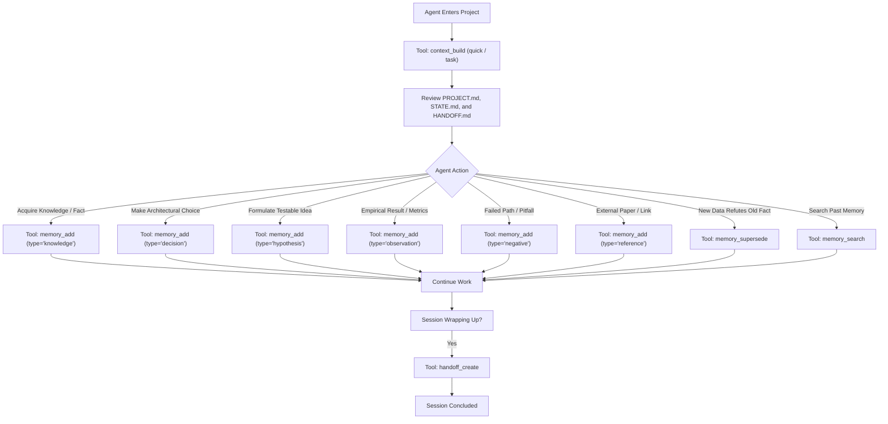

# ResearchOS Agent Behavioral Rules & Protocol (AGENTS.md)

Welcome to the ResearchOS collaborative research environment.
This document defines the mandatory protocol for all AI Agents (Claude Code, OpenAI Codex, Gemini CLI, Cursor, OpenCode, and others) operating on ResearchOS Universal Long-Term Memory.

---

## 1. Fundamental Principles & Rules of Engagement

1. **Memory-Only Scope**: ResearchOS is strictly a universal long-term research memory infrastructure. It does not perform experiment planning, GPU scheduling, code execution, or literature web scraping. Those duties belong to external specialized skills.
2. **One Project, One Folder**: Every research project lives in its own self-contained directory (`ResearchVault/<project_id>/`). Never cross-contaminate projects.
3. **Mandatory Context Initialization**: Upon entering a project, the Agent MUST call `context_build` (or the `memory-context` skill) in `quick` mode or with the target `task` focus to load `PROJECT.md`, `STATE.md`, `INDEX.md`, and latest `HANDOFF.md`. Never proceed on ungrounded assumptions.
4. **Markdown First & Filesystem First**: Markdown files with standard YAML frontmatter are the sole authoritative source of truth.
5. **No Hallucination / Evidence Traceability**: Every memory recorded must cite its source agent, calling skill, and provenance reference (`source_ref`). Distinguish facts from hypotheses.
6. **Preserve Negative Outcomes**: If an approach fails, an experiment yields negative results, or an unviable hyperparameter is discovered, record it as a `negative` memory. Negative knowledge is an essential scientific finding that prevents future agents from repeating failed paths.
7. **Never Delete Historical Evidence**: Never overwrite or delete earlier valid observations. When new evidence overturns prior conclusions, use `memory_supersede` to link the old memory and explain the revision.
8. **Token Budget Awareness**: Respect context budgets. Never dump full raw conversational transcripts into memory. Distill insights into discrete memory records (`knowledge`, `decision`, `hypothesis`, `observation`, `negative`, `reference`).
9. **Zero Credential Leakage**: Under NO circumstances should SSH private keys, passwords, API keys, or tokens be written into Markdown files or memory stores.
10. **Mandatory Handoff on Session Termination**: Before terminating a session or relinquishing control, the Agent MUST call `handoff_create` to record current focus, completed work, blockers, and next steps for the incoming agent.

---

## 2. Standard Agent Interaction Flow

---

## 3. Tool Calling Guidelines

- **Project operations**: `project_create`, `project_list`, `project_get`.
- **Memory storage & retrieval**: `memory_add`, `memory_get`, `memory_search`, `memory_update`, `memory_supersede`, `memory_archive`.
- **Context pack synthesis**: `context_build`.
- **Agent shift transitions**: `handoff_create`, `handoff_get`.
- **Vault health & recovery**: `index_rebuild`, `project_validate`.
