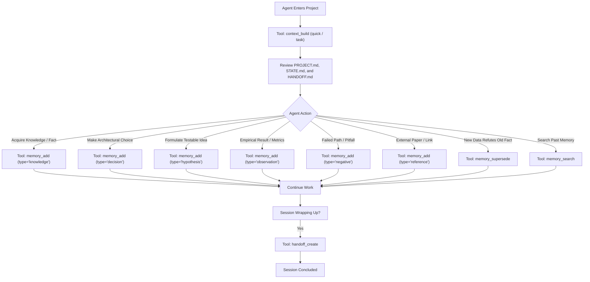

# ResearchOS Agent Behavioral Rules & Protocol (AGENTS.md)

Welcome to the ResearchOS collaborative research environment.
This document defines the mandatory protocol for all AI Agents (Claude Code, OpenAI Codex, Gemini CLI, Cursor, OpenCode, and others) operating on ResearchOS Universal Long-Term Memory.

---

## 1. Fundamental Principles & Rules of Engagement

1. **Memory-Only Scope**: ResearchOS is strictly a universal long-term research memory infrastructure. It does not perform experiment planning, GPU scheduling, code execution, or literature web scraping. Those duties belong to external specialized skills.
2. **One Project, One Folder**: Every research project lives in its own self-contained directory (`ResearchVault/<project_id>/`). Never cross-contaminate projects.
3. **Mandatory Context Initialization**: Upon entering a project, the Agent MUST review `MEMORY.md` (Always-on Project Memory) and call `context_build` in `quick` mode (which automatically embeds `MEMORY.md` at Priority 1) or with the target `task` focus to load `PROJECT.md`, `STATE.md`, `INDEX.md`, and latest `HANDOFF.md`. Never proceed on ungrounded assumptions.
4. **Markdown First & Filesystem First**: Markdown files with standard YAML frontmatter are the sole authoritative source of truth.
5. **No Hallucination / Evidence Traceability**: Every memory recorded must cite its source agent, calling skill, and provenance reference (`source_ref`). Distinguish facts from hypotheses.
6. **Preserve Negative Outcomes**: If an approach fails, an experiment yields negative results, or an unviable hyperparameter is discovered, record it as a `negative` memory. Negative knowledge is an essential scientific finding that prevents future agents from repeating failed paths.
7. **Never Delete Historical Evidence**: Never overwrite or delete earlier valid observations. When new evidence overturns prior conclusions, use `memory_supersede` to link the old memory and explain the revision.
8. **Token Budget Awareness**: Respect context budgets. Never dump full raw conversational transcripts into memory. Distill insights into discrete memory records (`knowledge`, `decision`, `hypothesis`, `observation`, `negative`, `reference`).
9. **Zero Credential Leakage**: Under NO circumstances should SSH private keys, passwords, API keys, or tokens be written into Markdown files or memory stores.
10. **Mandatory Handoff on Session Termination**: Before terminating a session or relinquishing control, the Agent MUST call `handoff_create` to record current focus, completed work, blockers, and next steps for the incoming agent.

---

## 2. Standard Agent Interaction Flow

---

## 3. Tool Calling Guidelines

- **Project operations**: `project_create`, `project_list`, `project_get`.
- **Always-on Project Memory (MEMORY.md)**: `project_memory_get`, `project_memory_update`, `project_memory_validate`, `project_memory_rebuild`.
- **Memory storage & retrieval**: `memory_add`, `memory_get`, `memory_search`, `memory_get_related`, `memory_update`, `memory_supersede`, `memory_archive`.
- **Context pack synthesis**: `context_build` (supports `quick`, `task`, `full` modes; `quick` automatically embeds `MEMORY.md` at Priority 1).
- **Paper Writing & Evidence Tracking**: `paper_evidence_inventory` (fine-grained status and section breakdown), `paper_evidence_coverage` (audit loaded vs pending vs missing evidence).
- **Agent shift transitions**: `handoff_create`, `handoff_get`.
- **Vault health & recovery**: `index_rebuild`, `project_validate` (with `strict=True` link and relation checking).

---

## 4. Always-on Project Memory (MEMORY.md) Protocol

1. **Role of MEMORY.md**: Every project contains an independent `<project_id>/MEMORY.md` (~2,000 token budget) that serves as the resident project briefing.
2. **Distinction of Truth**:
   - `MEMORY.md`: High-value synthesized summary.
   - `INDEX.md`: Full catalog navigation.
   - Detailed memories (`<type>/MEM-*.md`): Authoritative empirical evidence.
3. **Citation & Grounding**: Every finding or conclusion in `MEMORY.md` must link to its authoritative `memory_id`.
4. **No Fabrication**: Unestablished sections must explicitly state `_Unknown_` or `_Not yet established_`.
5. **The 10 Canonical Sections**:
   - `## 1. Project Identity`
   - `## 2. Core Research Idea`
   - `## 3. Confirmed Findings`
   - `## 4. Current Hypotheses`
   - `## 5. Important Decisions`
   - `## 6. Current Research Status`
   - `## 7. Paper Structure`
   - `## 8. Important Memory Pointers`
   - `## 9. Next Actions`
   - `## 10. Important Warnings`

---

## 5. Paper Writing Mode Protocol

When writing or outlining papers, avoid dumping raw experiments into context:
- **Phase A (Inventory)**: Call `paper_evidence_inventory(project_id)` to view metadata-only status of all experiments (including completed, failed, interrupted, and running).
- **Phase B (Section Filter)**: Filter by `paper_section` (e.g. `methodology`, `experiments`, `ablations`, `discussion`).
- **Phase C (On-Demand Retrieval)**: Use `memory_get(memory_id)` to retrieve exact quantitative metrics and setup details for needed memories only.
- **Phase D (Evidence Coverage)**: Call `paper_evidence_coverage(project_id, target_section, loaded_memory_ids)` to detect missing evidence, unverified claims, or missing artifact files on disk before writing.
