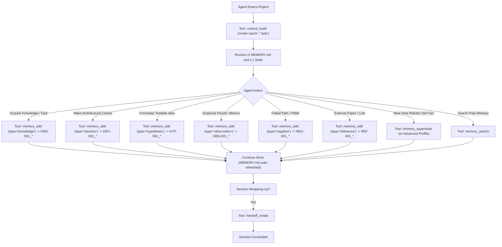

# ResearchOS Agent Behavioral Rules & Protocol (AGENTS.md)

Welcome to the ResearchOS collaborative research environment.
This document defines the mandatory protocol for all AI Agents (Claude Code, OpenAI Codex, Gemini CLI, Cursor, OpenCode, and others) operating on ResearchOS Universal Long-Term Memory.

---

## 1. Fundamental Principles & Rules of Engagement

1. **Memory-Only Scope**: ResearchOS is strictly a universal long-term research memory infrastructure. It does not perform experiment planning, GPU scheduling, code execution, or literature web scraping. Those duties belong to external specialized skills.
2. **One Project, One Folder**: Every research project lives in its own self-contained directory (`ResearchVault/<project_id>/`). Never cross-contaminate projects.
3. **Mandatory Context Initialization**: Upon entering a project, the Agent MUST review `MEMORY.md` (Always-on Project Memory) and call `context_build` in `quick` mode (which automatically embeds `MEMORY.md` at Priority 1) or with the target `task` focus to load `PROJECT.md`, `STATE.md`, `INDEX.md`, and latest `HANDOFF.md`. Never proceed on ungrounded assumptions.
4. **Markdown First & Filesystem First**: Markdown files with standard YAML frontmatter are the sole authoritative source of truth.
5. **No Hallucination / Evidence Traceability**: Every memory recorded must cite its source agent, calling skill, and provenance reference (`source_ref`). Distinguish facts from hypotheses.
6. **Preserve Negative Outcomes**: If an approach fails, an experiment yields negative results, or an unviable hyperparameter is discovered, record it as a `negative` memory (`NEG-001_*`). Negative knowledge is an essential scientific finding that prevents future agents from repeating failed paths.
7. **Never Delete Historical Evidence**: Never overwrite or delete earlier valid observations. When new evidence overturns prior conclusions, use `memory_supersede` to link the old memory and explain the revision.
8. **Token Budget Awareness**: Respect context budgets. Never dump full raw conversational transcripts into memory. Distill insights into discrete memory records (`knowledge`, `decision`, `hypothesis`, `observation`, `negative`, `reference`).
9. **Zero Credential Leakage**: Under NO circumstances should SSH private keys, passwords, API keys, or tokens be written into Markdown files or memory stores.
10. **Mandatory Handoff on Session Termination**: Before terminating a session or relinquishing control, the Agent MUST call `handoff_create` to record current focus, completed work, blockers, and next steps for the incoming agent.

---

## 2. Standard Agent Interaction Flow

---

## 3. Tool Calling Guidelines & MCP Profiles

ResearchOS MCP Server operates with two tool exposure profiles configured via `--profile` or `RESEARCHOS_PROFILE=lite|advanced`:

### A. Lite Profile (Default — Exactly 6 Tools)
Recommended for all standard research workflows to minimize agent context overhead:
1. `project_get`: Read project metadata, research goal, constraints, and latest handoff summary.
2. `context_build`: Synthesize prioritized context packs (`quick`, `task`, `paper`, `full`).
3. `memory_add`: Atomically persist new research memories with standard prefixes (`DEC`, `OBS`, `NEG`, `HYP`, `REF`, `KNO`).
4. `memory_search`: Fast BM25 keyword and tag search strictly isolated to the current project.
5. `memory_get`: Retrieve complete details and quantitative metrics of a specific memory record by ID.
6. `handoff_create`: Conclude session, persist current state, and update `HANDOFF.md` / `MEMORY.md`.

### B. Advanced Profile (21+ Tools)
For administrative maintenance, index reconstruction, and deep paper auditing:
- `project_create`, `project_list`, `project_memory_get`, `project_memory_update`, `project_memory_validate`, `project_memory_rebuild`, `memory_get_related`, `memory_update`, `memory_supersede`, `memory_archive`, `handoff_get`, `index_rebuild`, `project_validate`, `paper_evidence_inventory`, `paper_evidence_coverage`.

---

## 4. Always-on Project Memory (MEMORY.md) Protocol

`MEMORY.md` is an automatically synthesized, lightweight snapshot (~400–800 tokens, soft cap 1,000, hard cap 1,200) designed for instant context re-orientation.

### The 4 Standard Canonical Sections:
1. `## 1. STABLE MEMORY`: Long-term stable facts:
   - `### Project Identity`: Project Name, Research Goal, Core Question, Project Root.
   - `### Fixed Constraints`: Immutable architecture or resource limits.
   - `### Key Decisions`: Essential architectural choices and reference IDs (`DEC-001_*`).
2. `## 2. WORKING MEMORY`: Continuously evolving research state:
   - `### Current Stage`: Present phase of research.
   - `### Current Task`: Immediate in-flight subtask.
   - `### Last Completed Work`: Bulleted accomplishments from recent runs.
   - `### Next Actions`: Numbered sequential priorities for the incoming agent.
   - `### Current Blockers`: Unresolved blockers or resource bottlenecks.
   - `### Open Questions`: Active scientific or engineering uncertainties.
3. `## 3. CRITICAL WARNINGS`: Verified pitfalls (`NEG-001_*`) to prevent repeating failed paths.
4. `## 4. MEMORY POINTERS`: Navigation links to `PROJECT.md`, `STATE.md`, `HANDOFF.md`, `INDEX.md`, and `records/`.

---

## 5. Context Compaction & Lifecycle Hook Protocol

When running under agents supporting lifecycle hooks (Claude Code, Antigravity/Gemini CLI, Codex):
- **Event A (Session Start)**: Hook discovers the active project via `ProjectResolver` (zero guessing) and injects the current `MEMORY.md`.
- **Event B (Pre-Compaction)**: Hook captures volatile state and updates `STATE.md` / `HANDOFF.md` before summarization.
- **Event C (Post-Compaction — CORE)**: Automatically restores working memory and next actions into the new compacted context window.
- **Event D (Session End)**: Creates immutable handoff records and refreshes `MEMORY.md`.

---

## 6. Three-Level Retrieval Strategy

1. **L0 (Quick)**: Call `context_build(context_mode='quick')` — loads solely `MEMORY.md` (< 800 tokens).
2. **L1 (Task Context)**: Call `context_build(context_mode='task', task='...')` — loads `MEMORY.md`, `PROJECT.md`, `STATE.md`, `HANDOFF.md`, and BM25-matched relevant memories.
3. **L2 (Paper Evidence)**: Call `context_build(context_mode='paper', paper_section='...')` — loads structured evidence tables with Run IDs, metrics summaries, and explicit hypothesis disclaimer tags (`[Hypothesis - Unverified Claim]`).
