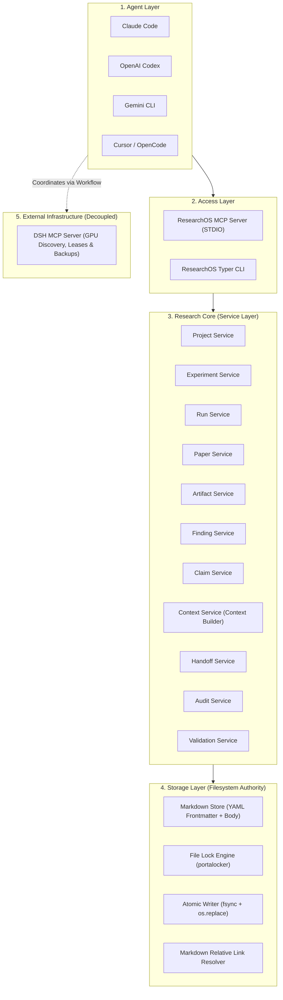

# ResearchOS Architecture & System Design

## 1. Executive Summary

ResearchOS is an autonomous, agent-agnostic, and Obsidian-optional scientific research management framework.
It is engineered to solve context degradation in long-running research tasks, coordinate multiple distinct LLM agents (Claude Code, OpenAI Codex, Gemini CLI, Cursor, OpenCode, etc.), and maintain an immutable, evidence-backed chain of custody from hypothesis formulation to publication claims.

---

## 2. Layered Architecture

---

## 3. Core Architectural Decisions

### 3.1 Markdown-first & Filesystem-first
- No relational DB (PostgreSQL/SQLite) or vector database is required to run ResearchOS.
- Filesystem is the single source of truth.
- Every research object is stored as a standard Markdown file with YAML Frontmatter.
- Even if ResearchOS is completely uninstalled, all research records remain 100% readable and editable with any basic text editor.

### 3.2 Dual Access Layer: MCP & CLI Parity
- CLI (`research ...`) and MCP (`research_*`) invoke the exact same Python Service Layer.
- No business logic or state machine rule is duplicated or diverges between CLI and MCP.

### 3.3 Strict Segregation of Design and Execution
- `Experiment`: Represents scientific hypothesis, methodology, planned hyperparameters, and success criteria.
- `Run`: Represents an immutable execution instance with actual hyperparameters, real random seeds, git commit hash, execution logs, and output metrics.
- Planned parameters are never blindly copied into actual parameters.

### 3.4 Context Builder & Inter-Agent Handoff
- Solves LLM context window compression and lost history.
- Instead of feeding massive raw chat logs to an incoming agent, `research context build <EXP-ID>` deterministically aggregates only the relevant project background, hypotheses, literature citations, prior runs, deviations, and warnings.
