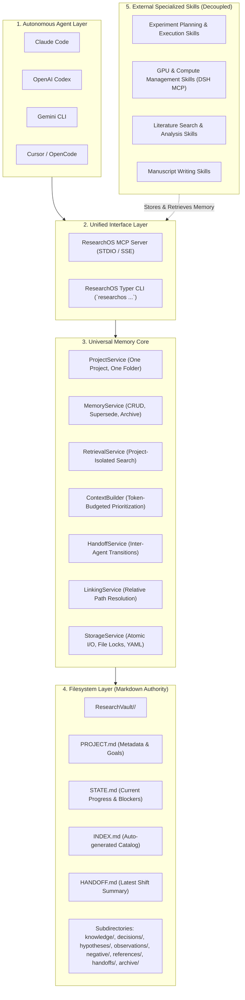

# ResearchOS Architecture & System Design (v2 Universal Memory)

## 1. Executive Summary

ResearchOS is an **Agent-independent, Skill-independent, Project-isolated, Markdown-first** universal long-term scientific research memory infrastructure.

It is designed to solve context degradation in long-running research tasks, coordinate multiple distinct LLM agents (Claude Code, OpenAI Codex, Gemini CLI, Cursor, OpenCode, etc.), and maintain an immutable, evidence-backed chain of custody for scientific knowledge, decisions, hypotheses, observations, and negative lessons.

ResearchOS strictly focuses on **research memory**—it does not manage compute servers, execute model training, or scrape papers. Those tasks are delegated entirely to external specialized skills.

---

## 2. Layered Architecture

---

## 3. Core Architectural Decisions

### 3.1 One Project, One Folder & Strict Project Isolation
- Each research project resides in its own self-contained directory (`ResearchVault/<project_id>/`).
- Queries, searches, and context building are scoped strictly to the target project by default.
- Cross-project access is only permitted when explicitly requested (`cross_project=True`).

### 3.2 Markdown-first & Filesystem-first
- No relational DB (PostgreSQL/SQLite) or vector database is required to run ResearchOS.
- Plain filesystem storage is the sole authoritative data source.
- Every memory is stored as an independent Markdown file with standard YAML Frontmatter.
- Projects are 100% portable: copying or moving the project folder to any other machine preserves all relative links and memory integrity.

### 3.3 Interface Parity: MCP and CLI
- CLI commands (`researchos project ...`, `researchos memory ...`, etc.) and MCP tools (`project_create`, `memory_add`, etc.) invoke the exact same Python Core Services.
- Business logic is centralized in `src/researchos/core/`; interfaces contain zero duplicate domain logic.

### 3.4 Token-Budgeted Context Builder
- Solves LLM context window bloat and lost history.
- Instead of dumping raw chat logs, `context_build` prioritizes:
  1. `PROJECT.md` (Background & scope)
  2. `STATE.md` (Current facts & progress)
  3. `HANDOFF.md` (Latest shift handoff)
  4. Task-relevant memories
  5. Unresolved decisions
  6. Negative lessons & pitfalls
  7. Recent observations
  8. Historical memories
- Strictly respects `max_tokens` budgets and cites the authoritative source file path for every block (`> **Source**: <path>`).

### 3.5 Superseding vs. Destructive Overwriting
- Historical scientific data is never deleted or overwritten in place when new contradictory results emerge.
- `memory_supersede` keeps the original memory record (updating status to `superseded`), creates a new memory record, links them via `supersedes: <old_id>`, and documents the rationale for the revision.

### 3.6 Resilient Index Reconstruction
- Memory markdown files are authoritative.
- `INDEX.md` is a derived summary index. If deleted or corrupted, running `index_rebuild` scans the project folder and fully reconstructs `INDEX.md` without data loss.
