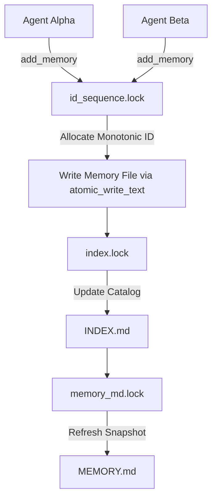

# Multi-Agent Concurrency & Shared Vault Protocol

ResearchOS is engineered from the ground up to support multiple autonomous agents (e.g. Claude Code, Codex, Antigravity, OpenCode) collaborating simultaneously within the same research project or across different projects without data corruption or race conditions.

---

## 1. Concurrency Architecture

ResearchOS achieves thread-safe and process-safe concurrency on the local filesystem using standard file locking (`portalocker`) and atomic file swaps.

### Dedicated Fine-Grained Locks
To prevent global bottlenecking, locks are granularly isolated under `<project_dir>/.researchos/`:

| Lock File | Scope | Protected Resource | Timeout |
| :--- | :--- | :--- | :--- |
| `id_sequence.lock` | Monotonic ID Counter | `id_sequence.json` allocation | 10.0s |
| `memory_md.lock` | Snapshot Generation | `MEMORY.md` 4-section synthesis | 10.0s |
| `index.lock` | Index Catalog | `INDEX.md` catalog rebuild | 10.0s |
| `handoff.lock` | Agent Transitions | `HANDOFF.md` updates and shift logs | 5.0s |
| `project.lock` | Structural Mutations | Project creation, schema upgrades | 10.0s |
| `hook_events.lock` | Idempotency History | `hook_events.json` event log | 5.0s |

All locks are re-entrant per thread (`_local_locks`) and enforce strict deadlock timeouts.

---

## 2. Atomic Writes

Every Markdown and JSON modification is executed via `atomic_write_text`:
1. Writes content to an ephemeral temporary file (`.<filename>.<pid>_<thread>_<timestamp>.tmp`) in the destination directory.
2. Flushes and forces synchronization to disk.
3. Performs an atomic replace (`os.replace`) into the destination path.

Even if an agent process is killed or power is lost mid-write, the existing file remains uncorrupted.

---

## 3. Provenance & Attribution Tracking

In a multi-agent environment, accountability and reproducibility require strict provenance:
- **`source_agent`**: Explicit name or ID of the creating agent (e.g., `Claude-3.7-Sonnet`, `Agent-Arch`, `Gemini-Pro`).
- **`source_skill`**: The specialized calling skill or tool (e.g., `experiment-runner`, `literature-retrieval`).
- **`source_ref`**: The exact experiment Run ID, checkpoint path, or commit hash (e.g., `runs/exp102_vit_b16.pt`).

---

## 4. Conflict Resolution & Non-Clobbering Rules

1. **Never Overwrite Valid Historical Evidence**:
   When new experiment results refute an earlier observation or decision, call `memory_supersede` rather than editing or overwriting the old file. This creates an explicit bidirectional pointer (`supersedes` / `superseded_by`) and records the rationale.
2. **Preserve Custom Notes**:
   When agents update or rebuild `MEMORY.md`, user comments within `<!-- RESEARCHOS_CUSTOM_NOTES_START -->` blocks and `### Custom Notes` sections are automatically preserved.
3. **Additive Handoffs**:
   Each agent session termination calls `handoff_create`, which appends an immutable record to `handoffs/HAN-<id>.md` and safely updates `HANDOFF.md`.
